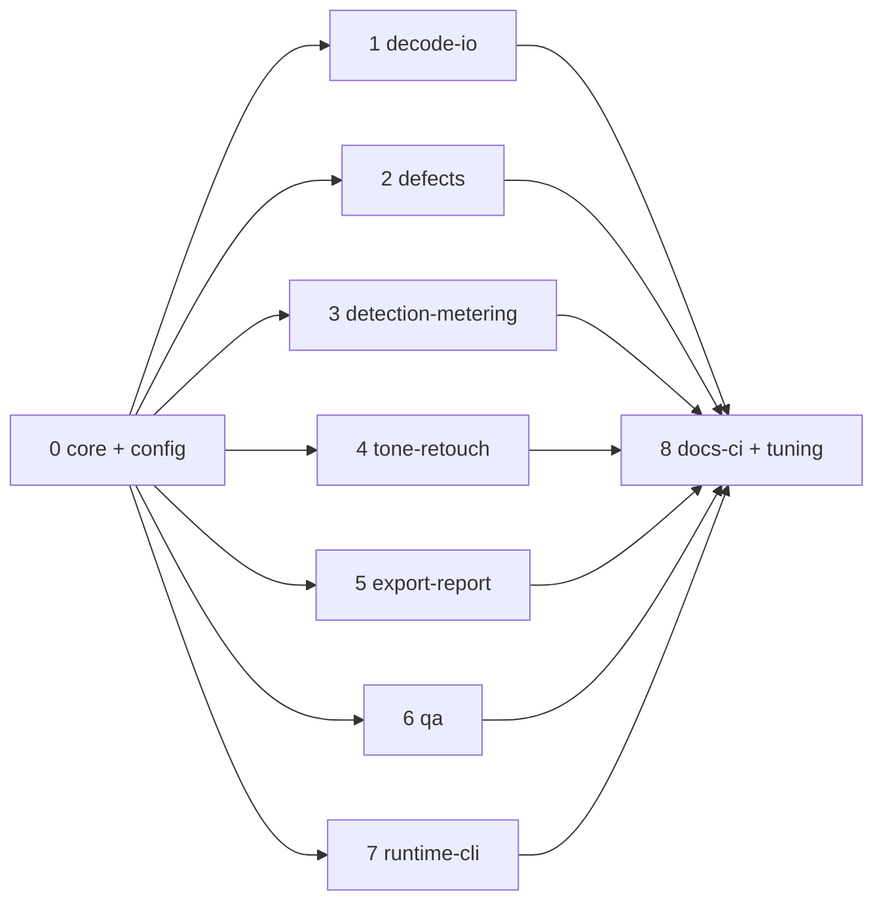

# Plan: initial build

Coordinator: main Devin session. Workers: one child Devin session per package,
branch `agent/<package>`, one PR per package into `master`.

Workers build against the contracts merged in the "core" package and **must not
edit `core/`, `config/` or another package's files**. Need a contract change?
Stop and ask the coordinator. Every worker also owns its tests under
`tests/unit/<its package dirs>/` (mirroring `src/`), one technical page
`docs/technical/components/<package>.md`, and one entry under `[Unreleased]`
in `CHANGELOG.md` (the coordinator resolves CHANGELOG conflicts).

Shared rules for every package: AGENTS.md (invariants, architecture,
coding standards, testing, definition of done). Components are registered with
the registries in `raw_pipeline.core.registries`, built through
`from_env(env: BuildEnv)`, read their settings with
`raw_pipeline.config.app_config(env)`, and pass the matching suite in
`tests/contract/`. Colour math comes from `raw_pipeline.core.color`. No
network in tests; no real photos in git (the repo is public).

## Dependency graph

Packages 1-7 run in parallel. Integration order: 2 defects, 1 decode-io,
3 detection-metering, 4 tone-retouch, 5 export-report, 6 qa, 7 runtime-cli
(runtime last so its end-to-end tests run against the real components), then 8.

## Packages

### 0. core + config (coordinator) — done first

Owns `core/`, `config/`, `pyproject.toml`, `config.example.yaml`, `tests/contract/`,
`tests/support/`, ADR 0001/0002, this plan, CI skeleton.

### 1. decode-io

Owns `stages/decode.py`, `io/`.

- `io/rawpy_decoder.py`: `RawpyDecoder` registered as `raw_decoders: rawpy`
  (`RawDecoder`/`RawHandle`). Opens files read-only; `read_cfa()` returns a copy of
  `raw_image_visible` with pattern/black/white levels; `develop(cfa)` writes the
  (corrected) CFA into the LibRaw buffer and postprocesses with camera WB,
  `output_bps=16`, `gamma=(1, 1)`, `no_auto_bright=True`, `output_color=sRGB`,
  `user_flip` default, configured demosaic/highlight mode; normalises to
  float32 where 1.0 = white level. `sensor_to_image` handles LibRaw flips.
- `io/exif.py`: `MetadataReader` (camera, lens, date, ISO, shutter, aperture,
  focal length, orientation, GPS presence) from rawpy/LibRaw metadata or the
  embedded EXIF; no extra dependency unless justified.
- `io/discovery.py`: sorted, case-insensitive `.CR2` discovery (non-recursive by
  default), never follows into the output dir.
- `io/output_naming.py`: output path planning; raises `OutputExistsError` unless
  `overwrite=True`; never writes into the input dir unless explicitly requested.
- `io/defects_yaml.py`: write a `DefectMap` to a standalone YAML file and merge it
  into a config file (`defects.map`), preserving other keys.
- `stages/decode.py`: `decode` stage: `read_cfa` → `DefectCorrector` (from
  `defect_corrector_registry` by `defects.method`) → `develop`. Records
  `decode.*` and `defects.method`, `defects.corrected_pixel_count`,
  `defects.count`. Sets EXIF in metadata, `BEFORE_IMAGE` (uncorrected develop,
  downscaled to `before_preview_long_edge_px`; reuses the corrected image when
  method is `none`), and `DEFECT_CROPS` (100 % `report.defect_crop_px` crops of the
  first defect, before/after) when correction is enabled. Never mutates the input.

Acceptance: decoder/stage unit tests with a fake `RawHandle` (no CR2 needed);
stage contract suite; input-hash test; `OutputExistsError` test; optional
`@pytest.mark.slow` tests that skip when `tests/fixtures/*.CR2` is absent.

### 2. defects

Owns `defects/`.

- `NullDefectCorrector` (`none`): returns the same frame object, count 0.
- `NeighborAverageCorrector` (`neighbor_average`): each masked photosite = mean of
  nearest non-masked same-colour photosites on both sides perpendicular to the
  line (columns: left/right; rows: up/down; pixels: all 8 same-colour
  neighbours). Handles width > 1, partial lines, image borders (one-sided).
- `DirectionalCorrector` (`directional`): per photosite estimates gradients
  along candidate directions (horizontal, vertical, two diagonals) from
  non-masked same-colour neighbours, interpolates along the lowest-gradient
  direction, so edges crossing the line stay sharp.
- `defects/detection.py`: `StatisticalDefectDetector` (`DefectDetector`): streams
  frames, per-colour-plane robust statistics (median/MAD) of column means, row
  means and per-pixel values; flags outliers above `outlier_threshold_sigma` that
  appear in ≥ `min_frame_fraction` of frames; groups adjacent columns/rows into
  `width`, detects partial extents (`start`/`end`), caps pixels at
  `max_pixel_defects`. A single dark frame is the best input; batch mode works on
  portraits by using high-pass residuals.

Acceptance: defect-corrector contract suite for all three; synthetic CFA tests:
hot vertical and horizontal lines, partial line, width 2-3, single pixels, a
sharp edge crossing the line (directional error ≪ neighbour average),
untouched non-defective pixels, `none` passthrough, uint16 range respected;
detector finds injected defects with no false positives on clean noise.

### 3. detection-metering

Owns `detection/`, `metering/`, `stages/meter.py`.

- `detection/mediapipe_detector.py` (`mediapipe`): MediaPipe **Tasks** API (the
  installed version has no `mediapipe.solutions`): `FaceDetector` for boxes and
  `FaceLandmarker` for the 478-point mesh (`landmark_scheme =
  "mediapipe_face_mesh_478"`). The pipeline must work offline, so the `.tflite`
  / `.task` models are vendored under `src/raw_pipeline/detection/models/`
  (Apache-2.0; document source URL, licence and size) and loaded from there.
  MediaPipe has no Intel-macOS wheel, so it is not installed there
  (environment marker in `pyproject.toml`): import it lazily and raise
  `DetectionError` with a clear message so the meter stage uses the OpenCV fallback.
- `detection/opencv_detector.py` (`opencv`): Haar/YuNet fallback with models
  shipped by `opencv-python-headless` (no download).
- `metering/face_weighted.py` (`face_weighted`), `metering/center_weighted.py`
  (`center_weighted`): EV correction `log2(target / measured)` clamped to
  `±max_correction_ev`, robust (trimmed mean or median) luminance via
  `core.color.luminance`, face region = central skin part of the box
  (exclude hair/background).
- `stages/meter.py`: builds the gamma-encoded uint8 preview
  (`detection_long_edge_px`), runs detector then fallback detector, maps faces
  with `preview_to_full`, chooses strategy (fallback when no face), sets `FACES`
  and `EXPOSURE`, records `meter.*`. Does not change pixels.

Acceptance: face-detector contract suite (detectors must return `[]` on a blank
image; MediaPipe/OpenCV tests on synthetic inputs, real-face tests skip without
fixtures); metering contract suite; synthetic face test (face patch lands on target
after correction); center-weighted fallback test; clamp test.

### 4. tone-retouch

Owns `stages/tone.py`, `stages/retouch.py`, `stages/retouchers/` (retoucher implementations).

- `tone` stage: multiply by `2**ev` from `EXPOSURE` (0 when absent), smooth
  highlight shoulder starting at `highlight_rolloff_start_ev` relative to 1.0
  and compressing `highlight_rolloff_ev` of headroom into it, shadow lift up to
  `shadow_lift_ev` below `shadow_pivot_luminance`; applied on luminance with
  hue-preserving RGB scaling; monotonic and C1-continuous. Records all parameters.
- `retouch` stage + `Retoucher`s: `none` (Null Object) and
  `frequency_separation`: skin mask from face-mesh landmarks (face oval minus
  eyes, eyebrows, lips, mouth interior, nostrils, with `mask_feather_px`
  feathering); box-ellipse fallback without landmarks; low-frequency layer
  smoothed with a radius proportional to face size, high-frequency texture kept
  (blend at `strength`, never full removal). Records strength and mask coverage.

Acceptance: stage contract suites; tone curve monotonic, no NaN/Inf, identity
at 0 EV with zero lift/rolloff away from the knees, EV scaling exact in the
mid-tones; retouch changes nothing outside the mask and inside eye/brow/lip
regions (bitwise), texture std retained above a threshold.

### 5. export-report

Owns `exporters/` (including batch reporters in `exporters/reporters/`),
`stages/export.py`, `stages/report.py`.

- `jpeg` and `tiff` (16-bit) exporters: clip, `core.color.srgb_encode`, optional
  resize (`long_edge_px`, area filter), embedded sRGB ICC profile (generated
  with Pillow `ImageCms` or vendored, deterministic), EXIF preserved
  (camera, lens, date, ISO, shutter, aperture), GPS stripped unless `keep_gps`,
  no timestamps or other non-deterministic fields, `OutputExistsError` without
  overwrite.
- `export` stage: runs the configured exporters, sets `OUTPUT_PATHS`.
- `report` stage: builds `REPORT_THUMBNAILS` (before/after and defect crops,
  sRGB uint8).
- reporters: `csv` (one row per image, every metadata record flattened as
  `stage.param`, stable column order, failures included) and `contact_sheet`
  (grid of before/after with filename and key parameters, plus 100 % defect crops
  when present; deterministic JPEG).

Acceptance: exporter contract suite (valid file, ICC present, byte-identical
reruns, no silent overwrite); CSV round-trip test; contact sheet dimensions and
determinism test; GPS stripping test.

### 6. qa

Owns `qa/`, `stages/qa.py`.

- `none` (`NullQAProvider`), `openai_compatible` (standard library `urllib`,
  JSON chat-completions with an image data URL; endpoint/model from config, key from
  `api_key_env`; no SDK dependency unless justified). Missing key → skipped with a
  warning; HTTP/timeout/parse errors → skipped with a warning; never raises,
  never logs the key.
- `qa` stage: builds the preview (≤ 1024 px long edge, enforced, JPEG,
  EXIF-free), calls the provider, sets `QA_RESULT`, records `qa.*` flags. Never
  changes pixels.

Acceptance: QA provider contract suite; fake HTTP transport tests (success,
error, timeout, malformed response); preview size/EXIF-free test; no network.

### 7. runtime-cli

Owns `runtime/`, `cli.py`.

- `runtime/components.py`: imports built-in component modules (to run
  registrations) and loads entry points; builds the `ComponentCatalog` for
  `validate_components`.
- `Pipeline` (ordered stages, per-stage timing via observer), `PipelineFactory`
  (config → pipeline via registries), `BatchRunner` (process pool,
  `workers` default CPU − 1, one image per task, per-image errors captured into
  `ImageOutcome`, deterministic ordering of outcomes, reporters fed in the main
  process), observers (logging, CLI progress).
- `DefectDetectionService`: reads frames through the raw decoder, runs the
  detector, returns a `DefectMap`.
- `cli.py`: `process input/ output/ --config [--overwrite] [--workers N] [-v/-q]`
  and `detect-defects input/ --config [--dark-frame path] [--output path] [--yes]`
  (prints findings; without `--output` asks for confirmation before merging into
  the config). Exit code non-zero if any image failed.

Acceptance: ≥ 90 % coverage of `runtime/`; tests with fake registered
components: order, error isolation, exit codes, overwrite refusal, parallel ==
serial output, confirmation prompt; input-hash test.

### 8. docs-ci + tuning (coordinator, after integration)

Functional docs (getting started, usage, configuration reference generated
from the pydantic schema, stages, QA and privacy, troubleshooting, dark-frame
and defect-detection guide), technical docs (architecture, extending,
colour pipeline, testing), CI green, sample-CR2 tuning and final contact sheet.

## Review

Each PR is reviewed by Devin Review (an agent that did not write the code)
against AGENTS.md before integration; the coordinator addresses findings.
