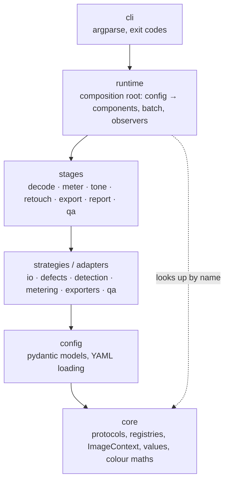
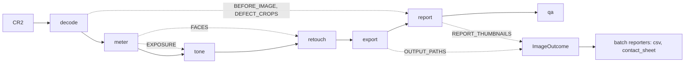

# Architecture

`raw_pipeline` is a layered package. Each image flows through a list of
`Stage`s that pass an immutable `ImageContext`; every interchangeable part
(decoder, defect corrector, detector, metering strategy, retoucher, exporter,
QA provider, reporter) is a small class behind a `Protocol` in
`raw_pipeline.core`, found by name in a `Registry`. Rationale:
[ADR 0001](../adr/0001-architecture-and-core-contracts.md); the protocols and
artifacts: [Core contracts](core-contracts.md).

## Layers

An arrow means "may import". Lower layers never import higher ones.

| Package | Role |
| --- | --- |
| `core` | Protocols, `Registry`, `ImageContext` and artifacts, value objects, errors, `color` and `geometry` helpers. Pure Python + NumPy. |
| `config` | `AppConfig` and its sections (pydantic), YAML loading, JSON schema. |
| `io` | `rawpy` decoder, EXIF reading, RAW discovery, output naming, defect-map YAML. |
| `defects` | Raw-level defect correctors and the statistical detector. |
| `detection` | Face detectors (MediaPipe, OpenCV). |
| `metering` | Exposure metering strategies. |
| `exporters` | JPEG/TIFF exporters, sRGB encoding, ICC, EXIF, batch reporters. |
| `qa` | Optional vision-LLM QA providers and preview encoding. |
| `stages` | The pipeline stages and the retouchers. |
| `runtime` | Builds everything from the config, runs the batch, observers, detect-defects service. |
| `cli` | The `raw-pipeline` command. |

## Import rules

Enforced by `uv run lint-imports` (in CI). Rendered from `pyproject.toml`:

<!-- generated:import-contracts -->

Packages on the same layer do not import each other's internals; when one
needs another's component it asks the registry (for example the `retouch`
stage builds the retoucher with `retoucher_registry.create(...)`).

## Per-image flow

- `ImageContext` is frozen: a stage returns a new context
  (`with_image`, `with_record`, `with_artifact`) and never mutates its input.
- Each stage records the parameters it applied with `ctx.with_record(name, {...})`;
  they become the `stage.param` columns of `report.csv`.
- A stage error fails that image only. `BatchRunner` runs images in worker
  processes (`--workers`) in a deterministic order; batch reporters run in the
  main process after all images.

`fix-raw` is a separate use case that never runs the stages: `RawExportService`
(`runtime/raw_export.py`) chains a `DngSource`, the `DngRawWriter`, the
placement helpers in `defects/` and the configured `DefectCorrector`
([DNG export](components/dng.md), [ADR 0003](../adr/0003-corrected-dng-export.md)).

## Composition root

`raw_pipeline.runtime` is the only place that knows concrete classes:

1. `load_config` validates the YAML into `AppConfig`.
2. `load_components` imports every built-in module (their decorators register
   them) and loads [entry-point plugins](extending.md#entry-point-plugins).
3. `ComponentRegistries.validate` reports every unknown name at once.
4. `PipelineFactory` builds the stages in `pipeline.stages` order; each
   component builds itself with `from_env(BuildEnv)`.

Details: [Runtime and CLI](components/runtime-cli.md).
