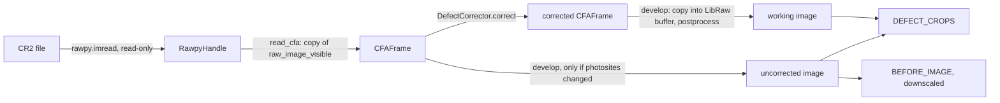

# Decode and IO

Package **decode-io**: `stages/decode.py` and `io/`. Reads Canon CR2 files
read-only, corrects sensor defects at raw level (ADR 0002), demosaics with
LibRaw and plans where outputs go.

## Data flow

## Components

| Module | Registered as | Role |
| --- | --- | --- |
| `io/rawpy_decoder.py` | `raw_decoders: rawpy` | `RawpyDecoder` / `RawpyHandle` (`RawDecoder` / `RawHandle`) |
| `io/exif.py` | — | `ExifReader` (`MetadataReader`) |
| `io/discovery.py` | — | `discover_raw_files` |
| `io/output_naming.py` | — | `OutputPlanner`, `ensure_writable` |
| `io/defects_yaml.py` | — | `write_defect_map`, `merge_defect_map_into_config` |
| `stages/decode.py` | `stages: decode` | `DecodeStage` |

### rawpy decoder

- `read_cfa()` returns a **copy** of `raw_image_visible` plus the 2×2 pattern
  (`raw_colors_visible`), `color_desc`, per-channel black level and white level.
- `develop(cfa)` copies the CFA into LibRaw's in-memory buffer
  (`raw_image_visible[...] = cfa.data`) and calls `postprocess` with camera WB,
  `output_bps=16`, `gamma=(1, 1)`, `no_auto_bright=True`, `output_color=sRGB`,
  `adjust_maximum_thr=0`, the configured `demosaic` and `highlight_mode`, and
  LibRaw's default `user_flip` (camera orientation). The file on disk is never
  written; each `develop` overwrites the whole buffer, so developing the
  corrected and the uncorrected CFA from the same handle is safe.
- **No per-image maximum**: `adjust_maximum_thr=0` stops LibRaw from lowering
  the white level to the brightest value found in each file, so 1.0 means the
  sensor white level in every image (recorded as `decode.adjust_maximum_thr`).
- **Normalisation**: the 16-bit output is divided by 65535, so 1.0 is the white
  level of the least-amplified channel after black subtraction and WB. With
  `highlight_mode: clip` LibRaw normalises the WB multipliers by their minimum,
  so this is direct. With `blend`/`ignore`/`reconstruct` LibRaw normalises by
  their maximum (headroom for highlight recovery), which darkens the image by
  `max(wb) / min(wb)`; the adapter multiplies that factor back (recorded as
  `decode.white_scale`), so the exposure is the same in every mode and
  recovered highlights land above 1.0.
- `sensor_to_image(x, y)` implements LibRaw's `flip` code (4 = transpose,
  2 = vertical, 1 = horizontal): `0` none, `3` 180°, `5` 90° CCW, `6` 90° CW.
- Errors: missing/unreadable files and LibRaw failures raise `DecodeError`.

### EXIF

`ExifReader` parses the CR2's TIFF/EXIF IFDs with Pillow (already a
dependency; no pixel data is decoded): make, model, lens, `DateTimeOriginal`
(falls back to `DateTime`), ISO, exposure time, f-number, focal length,
orientation (1–8, else `None`) and GPS (`None` unless any tag besides the
version is present). Unreadable metadata logs a warning and yields an empty
`ExifInfo`; it never fails an image.

### Discovery and output naming

- `discover_raw_files(input_dir, recursive=False, exclude_dirs=())`: `.cr2`
  in any case, sorted case-insensitively by relative path, hidden files and
  directories skipped, symlinked directories never followed. Pass the output
  directory in `exclude_dirs` when it lives inside the input directory.
- `OutputPlanner(input_dir, output_dir, suffix, overwrite, allow_inside_input)`
  maps each input to an output path without suffix (exporters add `.jpg`/`.tif`),
  keeping subdirectories. It refuses an output directory inside the input
  directory unless `allow_inside_input`, a `suffix` with path separators, and
  two inputs mapping to the same output (`IMG_1.CR2` / `IMG_1.cr2`).
  `check_writable` / `ensure_writable` raise `OutputExistsError` unless
  `overwrite=True`.

### Defect YAML

- `write_defect_map(path, defect_map, overwrite=False)` writes a standalone,
  loadable partial config (`defects: {map: [...]}`), one flow-style entry per
  defect, atomically.
- `merge_defect_map_into_config(config_path, defect_map, method=None,
  output_path=None, overwrite=False)` replaces `defects.map` (and optionally
  `defects.method`), keeps every other key and their order, validates the
  result with `parse_config`, then writes atomically. YAML comments are lost
  (PyYAML), so an existing file is never rewritten silently: write to a new
  `output_path`, or pass `overwrite=True` to replace the target. Missing
  targets are created.

### Decode stage

`read_cfa` → `DefectCorrector.correct` (from `defect_corrector_registry` by
`defects.method`) → `develop`. Records:

- `decode.*`: decoder parameters (`demosaic`, `highlight_mode`, WB multipliers,
  black/white level, `white_scale`, `adjust_maximum_thr`, `flip`, `libraw_version`, size) and
  `before_preview`.
- `defects.method`, `defects.corrected_pixel_count`, `defects.count`.

Artifacts are produced **only when `report` is in `pipeline.stages`**: they
cost a second full-resolution demosaic and only the report consumes them.
Without `report`, `decode.before_preview` is `false` and neither artifact is
set.

- `BEFORE_IMAGE`: uncorrected development downscaled (area) to
  `decode.before_preview_long_edge_px`. When no photosite was replaced
  (method `none` or empty map) the corrected image is reused.
- `DEFECT_CROPS`: when a real corrector and a non-empty map are configured,
  `report.defect_crop_px` 100 % crops of the same image pixels around the
  centre of the first defect, before/after, mapped through `sensor_to_image`.

A defect map that does not fit the sensor raises `DefectCorrectionError`
for that image.

## Tests

- `tests/unit/io/`: fake `LibRawImage` (buffer write, postprocess options,
  normalisation, errors, flips checked against `np.rot90`), EXIF from a
  generated JPEG, discovery, output planning (`OutputExistsError`), defect YAML.
- `tests/unit/stages/test_decode.py`: fake decoder/handle/corrector; the stage
  contract suite (with a real and a `none` corrector); correction order,
  records, artifacts, rotation.
- `@pytest.mark.slow` tests decode the committed dark frame
  (`tests/fixtures/dark/dark_iso400.CR2`) and check its SHA-256 is unchanged.
