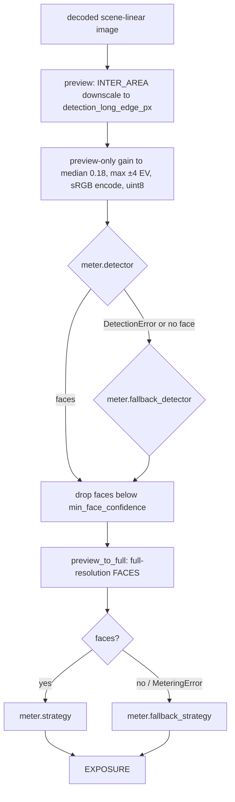

# Detection and metering

Package: `raw_pipeline.detection`, `raw_pipeline.metering`, `raw_pipeline.stages.meter`.

The `meter` stage finds faces on a small preview, maps them back to full
resolution and measures how many EV stops the image needs so the faces land on
a target luminance. It never changes pixels: it writes the `FACES` and
`EXPOSURE` artifacts that later stages (tone, retouch, report) consume.

## Components

| Registry | Name | Class | Role |
|---|---|---|---|
| `face_detector_registry` | `mediapipe` | `MediaPipeDetector` | Primary detector: MediaPipe Tasks `FaceDetector` (boxes) + `FaceLandmarker` (478-point mesh). |
| `face_detector_registry` | `opencv` | `OpenCVDetector` | Fallback: Haar frontal-face cascade shipped with OpenCV. Boxes only, no landmarks. |
| `metering_registry` | `face_weighted` | `FaceWeightedMetering` | Trimmed mean of the central skin area of the faces. |
| `metering_registry` | `center_weighted` | `CenterWeightedMetering` | Gaussian-weighted median of the whole frame; used when no face is found. |
| `stage_registry` | `meter` | `MeterStage` | Builds the preview, runs detectors and strategies, records `meter.*`. |

## Meter stage flow



- **Preview.** Detection runs on a gamma-encoded uint8 preview whose long edge is
  `meter.detection_long_edge_px` (never upscaled). Linear data straight from the
  decoder is often dark (no exposure applied yet), so the preview alone gets a gain
  that puts its median luminance at 0.18, clamped to ±4 EV. This only helps the
  detectors; metering always reads the untouched scene-linear image.
- **Detector order.** The primary detector runs first. If it raises
  `DetectionError` (MediaPipe missing, model missing, backend failure) or returns no
  face above `meter.min_face_confidence`, the fallback detector runs. Errors are
  logged and recorded in `meter.detection_errors`; they never fail the image.
- **Coordinates.** Detectors return preview coordinates. The stage maps boxes and
  landmarks with `core.geometry.preview_to_full`, so `FACES` is always in
  full-resolution pixel coordinates, sorted by decreasing area.
- **Strategy order.** With faces, `meter.strategy` measures. If it raises
  `MeteringError`, or there are no faces, `meter.fallback_strategy` measures.
- **Record.** `meter` records the detector used, detection errors, face counts,
  strategy and method used, whether the fallback was used, measured and target
  luminance, the correction in EV, the preview size and the preview gain.

## Metering formulas

Luminance is always `core.color.luminance` (scene-linear Rec. 709 / sRGB
weights). The image is subsampled to at most 1024 px on the long edge before
statistics, which keeps metering fast and does not change the result for smooth
regions.

The correction is

```text
EV = clamp(log2(target / max(measured, 1e-6)), -max_correction_ev, +max_correction_ev)
```

The tone stage applies it as a linear gain `2 ** EV`.

### `face_weighted`

1. Ignore faces whose area is below 25 % of the largest face (background people
   should not drive exposure).
2. For each face, keep the central skin area of the box: 25–75 % of the width and
   20–80 % of the height. This drops hair, ears, chin shadow and background
   corners that face boxes include.
3. Take the 20 %-trimmed mean of the luminance in that area (20 % cut from each
   end). Eyes, eyebrows, nostrils and specular highlights are removed by the trim.
4. Combine faces as an area-weighted mean.

Targets: `meter.target_face_luminance` (default 0.18).

### `center_weighted`

Weighted median of the luminance with an isotropic Gaussian weight centred on the
frame; sigma is `meter.center_weight_sigma_fraction` × the long edge. A median
keeps small bright sky patches or dark clothing from pulling the exposure.
Target: `meter.target_center_luminance`.

## Detectors

### MediaPipe (`mediapipe`)

- Uses the MediaPipe **Tasks** API (`mediapipe.tasks.vision.FaceDetector` and
  `FaceLandmarker`, IMAGE running mode). MediaPipe ≥ 1.x has no
  `mediapipe.solutions`.
- MediaPipe is imported lazily on the first `detect` call; if the import fails the
  detector raises `DetectionError` and the stage falls back to OpenCV.
- `FaceDetector` gives the boxes and scores (`min_detection_confidence` =
  `meter.min_face_confidence`). `FaceLandmarker` runs only when a face was found;
  each mesh is attached to the largest box that contains the mesh centroid, with
  `landmark_scheme = "mediapipe_face_mesh_478"`. A box without a matching mesh has
  `landmarks = None`.
- Task objects are created per call inside a `with` block so no native handle
  outlives the call; the detector itself only stores plain settings and is
  picklable for worker processes.

### OpenCV (`opencv`)

- `cv2.CascadeClassifier` with `haarcascade_frontalface_default.xml` from
  `cv2.data.haarcascades` (shipped inside `opencv-python-headless`, nothing is
  downloaded).
- Grey + histogram equalisation, `scaleFactor=1.1`, `minNeighbors=6`, minimum face
  size 6 % of the preview short edge. Haar gives no score, so `confidence = 1.0`.
- Frontal faces only: profiles and strongly rotated heads are not found.

## Vendored models (offline)

The models live in `src/raw_pipeline/detection/models/` and ship in the wheel;
nothing is downloaded at runtime.

| File | Size | SHA-256 | Source |
|---|---|---|---|
| `blaze_face_short_range.tflite` | 229 746 B | `b4578f35940bf5a1a655214a1cce5cab13eba73c1297cd78e1a04c2380b0152f` | `https://storage.googleapis.com/mediapipe-models/face_detector/blaze_face_short_range/float16/1/blaze_face_short_range.tflite` |
| `face_landmarker.task` | 3 758 596 B | `64184e229b263107bc2b804c6625db1341ff2bb731874b0bcc2fe6544e0bc9ff` | `https://storage.googleapis.com/mediapipe-models/face_landmarker/face_landmarker/float16/1/face_landmarker.task` |

Both are Google MediaPipe models released under the **Apache License 2.0**
(stated in their model cards); the licence text is in `models/LICENSE`. To update
a model, download the new file, replace it, update this table and run the
detector tests.

## Privacy and network

- Detection and metering run locally; no image data leaves the machine.
- MediaPipe's package notice says the Tasks APIs "send metrics about the
  performance and utilization of the APIs" to Google. In tests on Linux with
  MediaPipe 1.2.3, `strace` showed no outgoing `connect()` during detection, but
  this is not a guarantee for other platforms or versions. Users who need a strict
  no-network guarantee can set `meter.detector: opencv`.

## Tests

- `tests/unit/detection/`: contract suite for both detectors (blank image → no
  face, valid boxes), fake MediaPipe backend for sorting, clipping, confidence
  filtering and mesh assignment, missing-MediaPipe and missing-model errors.
- `tests/unit/metering/`: contract suite for both strategies, synthetic face patch
  lands on target, hair/background/specular rejection, clamp, area weighting.
- `tests/unit/stages/test_meter.py`: stage contract with and without faces,
  preview-to-full mapping, detector and strategy fallback, construction from
  config through the registries.
- Real-face tests run only when `RAW_PIPELINE_FACE_SAMPLES` points to a directory
  of JPG/PNG portraits outside the repository (marked `slow`); otherwise they skip.
