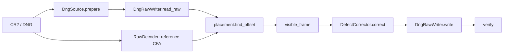

# DNG export (`fix-raw`)

`fix-raw` writes a converter-made DNG with the defect photosites corrected in
place ([ADR 0003](../../adr/0003-corrected-dng-export.md)). It is a separate use
case from the image pipeline; nothing is demosaiced except to render previews
and for LibRaw's open check.

## Pieces

| Piece | Module | Role |
| --- | --- | --- |
| `DngSource` | `core.protocols`, `io.dng.sources` | Produces the base DNG (`dnglab`, `adobe_converter`, `existing_dng`), registry `dng_sources` |
| `DngRawWriter` | `core.protocols`, `io.dng.writer` | Reads the CFA and patches it into a copy (`TiffDngRawWriter`) |
| TIFF layout | `io.dng.tiff` | Main raw IFD, strips/tiles, byte offsets of each photosite |
| Digests | `io.dng.digest` | `RawImageDigest` / `NewRawImageDigest` as in the DNG SDK |
| Previews | `io.dng.preview` | Renders and encodes replacement previews |
| Placement | `defects.placement` | Exact CR2-visible to DNG-stored offset; DNG levels into a `CFAFrame` |
| Verification | `defects.verification` | Detector scoring of the corrected frame |
| Service | `runtime.raw_export` | `RawExportService`: source → read → map → correct → write → verify |

Correction itself is the configured `DefectCorrector` from ADR 0002 applied to
a `CFAFrame` cut from the DNG; no correction code is specific to DNG.

## Locating the raw data

`read_layout` walks IFD0 and its `SubIFDs` and picks the IFD with
`NewSubfileType = 0` and `PhotometricInterpretation = 32803` (CFA).
`check_patchable` then rejects anything that cannot be patched safely:
BigTIFF, `LinearRaw` (34892), compression ≠ 1, `BitsPerSample` ≠ 16, more than
one sample, non-integer samples, `CFALayout` ≠ 1 and `LinearizationTable`
(the stored values would not be the sensor values the corrector works on).

`SampleGrid` describes strips or tiles (including padded edge tiles) and turns
`(row, column)` into a byte offset, honouring the file's byte order.

## Coordinate mapping

Defect coordinates are LibRaw visible-area coordinates of the CR2. The
reference CFA is read from the CR2 with the configured `RawDecoder`; the DNG
stores a (usually larger) raw image. `find_offset` tries, in order:

1. `ActiveArea` top-left,
2. `ActiveArea` + `DefaultCropOrigin`,
3. the origin,

and accepts a candidate only when **every** photosite of the reference equals
the DNG photosites there and the CFA colour at that offset matches the
reference pattern. If none matches, it searches ±64 photosites around each
candidate with the same rules (a seeded sample of 4096 photosites rejects most
offsets cheaply before the full comparison). No match, or more than one match
in the search, is a `CoordinateMappingError`; nothing is written.

On the EOS 800D, DNGLab's `ActiveArea` starts at row 34 while LibRaw's visible
area starts at row 36: the offset `(36, 264)` is found by the search, which is
why tags alone are never trusted.

`visible_frame` cuts the DNG photosites under the visible area and builds the
`CFAFrame` with the DNG's `BlackLevel` (mapped from DNG tile positions to
LibRaw channels) and `WhiteLevel`, because those describe the stored values.

## Writing

`TiffDngRawWriter.write` copies the base to a temporary file in the destination
folder, writes only the changed photosites (sorted, contiguous runs coalesced),
updates digests and previews, and publishes the file with a hard link (or
`os.replace` with `--overwrite`). Nothing else in the file moves.

### Digests

`RawImageDigest` is the MD5 of the raw samples in row order (16-bit
little-endian); `NewRawImageDigest` is the MD5 of the MD5s of 256×256 tiles
(row-major, the DNG SDK's `kTileSize`). Policy:

| Base DNG | Result (`digest` column) |
| --- | --- |
| No digest tags (DNGLab) | `absent` |
| Tags reproduce from the base data, nothing changed | `unchanged` |
| Tags reproduce, photosites changed | `recomputed` (new values written in place) |
| A tag does not reproduce (unknown variant) | `removed` (both tags dropped from IFD0) |

A digest is only rewritten when the algorithm provably matches what the
converter wrote, so the output never carries a digest that fails validation.

### Previews

Replaceable previews are uncompressed 8-bit RGB images (IFD0 thumbnail) and
baseline JPEG previews in `SubIFDs`. `regenerate` renders the corrected DNG
with rawpy (camera WB, half size, no rotation; previews are stored unrotated),
resizes it to each preview's size and writes it in place (JPEG: in place if it
fits, else appended and the offset/byte-count updated). `remove` blanks the
thumbnail and removes JPEG preview SubIFDs from `SubIFDs`. Previews of other
kinds are kept and the report says so.

## Testing

`tests/support/dng_builder.py` writes small synthetic DNGs (strips or tiles,
either byte order, digests, previews, compressed/linear/8-bit variants). Unit
tests cover layout, patching, digests, previews, rejection, mapping and the
service through the CLI; `tests/contract/dng_source_contract.py` is the
`DngSource` suite. `tests/integration/test_fix_raw_samples.py` (slow) runs
DNGLab, and Adobe DNG Converter when `RAW_PIPELINE_ADOBE_DNG_CONVERTER` is set,
on the sample CR2s; CI installs DNGLab for it.
