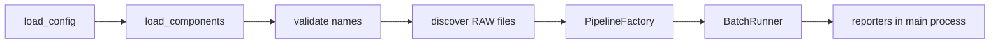

# runtime-cli

Composition root: turns a config file into running components and exposes the
`raw-pipeline` command. Lives in `raw_pipeline.runtime` and `raw_pipeline.cli`;
depends only on `core` and `config` (enforced by import-linter).

## Commands

```bash
raw-pipeline process input/ output/ --config config.yaml [--overwrite] [--workers N] [-v|-vv|-q]
raw-pipeline detect-defects input/ --config config.yaml [--dark-frame dark.CR2] [--output defects.yaml] [--overwrite] [--yes]
```

| Exit code | Meaning |
| --- | --- |
| 0 | Every image and every report succeeded. |
| 1 | At least one image, reporter or (for `detect-defects`) RAW frame failed; the others were still processed. |
| 2 | Bad arguments, invalid config, unknown component name, missing/empty input folder, output folder equal to the input folder. Nothing was processed. |

`process` prints one progress line per image to stderr (`[2/40] IMG_0002.CR2: ok`)
and a final `N ok, M failed` line; `-q` hides it. Logging goes to stderr
(`-v` info, `-vv` debug, `-q` errors only).

`detect-defects` analyses the batch (or only `--dark-frame`), prints each finding
in raw sensor coordinates using the `defects.map` YAML form, then:

- with `--output`: writes a standalone `.yaml`/`.yml` defects file (refused if it exists, unless `--overwrite`;
  the suffix is checked before any frame is read);
- otherwise: asks `[y/N]` before replacing `defects.map` in the `--config` file
  (`--yes` skips the question; no answer or end of input means no).

It never modifies RAW files and writes nothing when no defect is found.

## Flow of `process`



1. `load_config` validates the YAML; `load_components` imports every module of the
   built-in packages (`io`, `defects`, `detection`, `metering`, `exporters`, `qa`,
   `stages`) so their registrations run, then loads entry-point plugins. A module
   that fails with `ImportError` (e.g. a missing optional extra) is logged and
   skipped; its components are simply unregistered.
2. `ComponentRegistries.validate` reports every unknown component name at once,
   before any image is touched.
3. Discovery always passes the output folder in `exclude_dirs`, so outputs are never
   re-read as inputs, even when the output folder sits inside the input folder.
4. `PipelineFactory` builds the stages listed in `pipeline.stages`, in that order,
   and the reporters in `report.reporters`, through `Registry.create(name, env)`.
   This happens before the output folder is created: a `ConfigError` raised while
   building (for example QA enabled without `qa.endpoint`/`qa.model`) exits 2 with
   nothing written.
5. `BatchRunner` runs one image per task. `workers` is `--workers`, else
   `pipeline.workers`, else CPU count − 1. With more than one worker it uses a
   `spawn` process pool; outcomes come back in input order, so reports and the
   observer events are identical to a serial run.
6. `Pipeline.run` catches any exception raised by a stage and turns it into a
   failed `ImageOutcome` (error message and class name, metadata recorded up to the
   failing stage). The batch continues.
7. Reporters receive outcomes and are finalized in the main process. A reporter
   failure (in `add` or `finalize`) is recorded in `BatchResult.reporter_errors`,
   disables that reporter for the rest of the batch and makes the exit code 1.

## Main types

| Type | Module | Role |
| --- | --- | --- |
| `ComponentRegistries` | `runtime.components` | Bundle of the nine registries; `default()` = process-wide, `empty()` for tests. |
| `Pipeline` | `runtime.pipeline` | Ordered stages; returns an `ImageRun` (outcome + per-stage timings). |
| `PipelineFactory` | `runtime.factory` | Config → pipeline, reporters, RAW decoder. |
| `BatchRunner`, `BatchResult` | `runtime.batch` | Serial or process-pool batch; observer events; exit code. |
| `LoggingObserver`, `ProgressObserver`, `CompositeObserver` | `runtime.observers` | `PipelineObserver` implementations. |
| `DefectDetectionService` | `runtime.defect_detection` | Streams CFA frames from the decoder into a `DefectDetector`; unreadable frames are skipped and listed. |
| `RuntimeServices` | `runtime.services` | The io/defects functions the runtime calls (discovery, defects YAML writers, detector constructor), resolved lazily so tests inject fakes. |
| `process_batch`, `detect_defects`, `save_defect_map` | `runtime.app` | Use cases called by `cli.py`. |

## Notes

- `ImageMetadata` holds read-only mapping proxies, which do not pickle. Results
  crossing the process pool are converted to plain dicts and rebuilt in the parent.
- Stages are built once in the parent and pickled into each worker; they must be
  stateless between images (AGENTS.md).

## Testing

`tests/unit/runtime/` runs the whole runtime with fake stages, reporter, decoder
and detector registered in `ComponentRegistries.empty()`, and fake io services. It
covers stage order, per-image error isolation, exit codes, overwrite refusal,
serial/parallel equivalence, the confirmation prompt, `--dark-frame`, and that
input files are byte-identical after a run.
